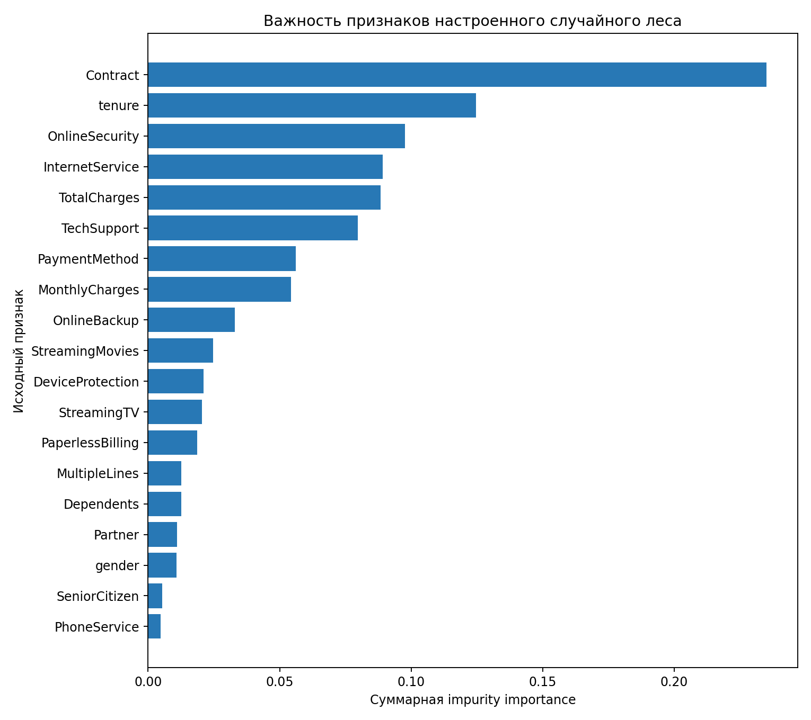

# Практическая работа № 7. Случайный лес

## Цель

Обучить ансамбль случайного леса для прогнозирования ухода клиентов, сравнить его с одиночным деревом решений, подобрать гиперпараметры и проверить, можно ли удалить малоинформативные признаки без потери качества.

## Данные и постановка задачи

Использован тот же датасет **IBM Telco Customer Churn**, что и в `practice-5`. Целевая переменная `Churn` принимает значения `Yes` и `No`.

- объектов: **7043**;
- исходных признаков после удаления идентификатора `customerID`: **19**;
- доля класса `Churn=Yes`: **26,54%**;
- train/test: **5634 / 1409**, стратифицированное разбиение 80/20;
- `random_state=42` во всех моделях.

`TotalCharges` преобразован в числовой тип. Пропуски в числовых признаках заполняются медианой, в категориальных — модой. Категориальные признаки кодируются `OneHotEncoder`, числовые стандартизируются. После предобработки обучающая матрица имеет размерность **(5634, 45)**.

Разбиение выполняется до обучения предобработки и моделей, поэтому утечки из test-выборки нет. Все модели сравниваются на одном и том же разбиении.

## Настройка случайного леса

Использован `GridSearchCV` со стратифицированной кросс-валидацией из 5 блоков. Перебирались 27 комбинаций:

```python
n_estimators = [100, 200, 300]
max_depth = [8, 14, None]
min_samples_leaf = [1, 2, 4]
```

Критерий выбора — средний **ROC-AUC**, подходящий при дисбалансе классов. Лучшие параметры:

```text
n_estimators=200
max_depth=8
min_samples_leaf=4
class_weight="balanced"
```

Лучший средний CV ROC-AUC: **0,8472**. Выбрано **200 деревьев**: именно это значение победило в кросс-валидации; оно даёт устойчивое усреднение, а дальнейшее увеличение до 300 деревьев в рассмотренной сетке не улучшило средний ROC-AUC.

## Сравнение моделей

| Модель | Accuracy | Precision | Recall | F1 | ROC-AUC |
|---|---:|---:|---:|---:|---:|
| Одиночное дерево решений | 0,7204 | 0,4745 | 0,4973 | 0,4856 | 0,6489 |
| Случайный лес по умолчанию | **0,7807** | **0,6117** | 0,4759 | 0,5353 | 0,8160 |
| Настроенный случайный лес | 0,7580 | 0,5302 | **0,7754** | **0,6298** | **0,8423** |

Случайный лес заметно превосходит одиночное дерево по ROC-AUC и F1: усреднение многих деревьев уменьшает разброс модели. Лес по умолчанию показывает более высокие accuracy и precision, но пропускает много уходящих клиентов. Настроенный лес с балансировкой классов существенно повышает recall — с 0,4759 до 0,7754 — и имеет лучшие F1 и ROC-AUC. Поэтому финальной выбрана настроенная модель.

OOB accuracy финального леса: **0,7632**, что близко к test accuracy 0,7580 и служит дополнительной внутренней оценкой обобщающей способности.

## Важность признаков



Пять наиболее важных исходных признаков по суммарной impurity importance:

| Признак | Важность |
|---|---:|
| Contract | 0,2351 |
| tenure | 0,1247 |
| OnlineSecurity | 0,0976 |
| InternetService | 0,0893 |
| TotalCharges | 0,0884 |

Модель чаще использует тип контракта, длительность обслуживания, наличие онлайн-защиты, вид интернет-услуги и общую сумму платежей. Это **не доказывает причинно-следственную связь**: важность показывает только полезность признака для разбиений данного леса на этих данных. Связанные и многокатегориальные признаки могут делить важность между собой или получать завышенную оценку.

## Эксперимент удаления признаков

Удалялись исходные признаки с наименьшей важностью, после чего финальный pipeline обучался заново на том же train и оценивался на том же test.

| Удалено | Удалённые признаки | F1 | ΔF1 | ROC-AUC | ΔROC-AUC |
|---:|---|---:|---:|---:|---:|
| 0 | — | 0,6298 | 0,0000 | 0,8423 | 0,0000 |
| 1 | PhoneService | 0,6348 | +0,0050 | 0,8424 | +0,0001 |
| 3 | PhoneService, SeniorCitizen, gender | 0,6311 | +0,0014 | 0,8419 | −0,0004 |
| 5 | PhoneService, SeniorCitizen, gender, Partner, Dependents | **0,6362** | **+0,0064** | **0,8427** | **+0,0004** |
| 7 | предыдущие 5 + MultipleLines, PaperlessBilling | 0,6243 | −0,0054 | 0,8389 | −0,0034 |

На данном фиксированном разбиении признаки `PhoneService`, `SeniorCitizen`, `gender`, `Partner` и `Dependents` можно исключить без потери качества: после их удаления F1 и ROC-AUC не снизились. Удаление уже семи признаков ухудшило обе метрики, поэтому `MultipleLines` и `PaperlessBilling` оставлены. Вывод относится к этому датасету и выбранной процедуре оценки; перед производственным удалением его следует подтвердить повторной вложенной кросс-валидацией.

## Файлы

- `random_forest_analysis.py` — полный воспроизводимый эксперимент;
- `model_output.txt` — вывод запуска;
- `model_metrics.csv` — метрики трёх моделей;
- `grid_search_results.csv` — результаты всех комбинаций GridSearchCV;
- `feature_importance.csv` и `feature_importance.png` — важность признаков;
- `feature_removal_experiment.csv` — эксперимент удаления признаков;
- `summary.json` — ключевые параметры и размерности;
- `requirements.txt` — зависимости.

## Запуск

Из корня репозитория:

```bash
python3 -m venv .venv
source .venv/bin/activate
pip install -r practice-7/requirements.txt
python3 practice-7/random_forest_analysis.py
```

По умолчанию скрипт использует CSV из `practice-5`. Можно передать другой путь первым аргументом:

```bash
python3 practice-7/random_forest_analysis.py /path/to/telco.csv
```

## Вывод

Настроенный случайный лес лучше одиночного дерева и базового леса по главным для несбалансированной задачи метрикам F1 и ROC-AUC. 200 деревьев выбраны кросс-валидацией. Эксперимент показал, что пять наименее важных признаков можно исключить без потери тестового качества, но более агрессивное сокращение уже ухудшает результат.
