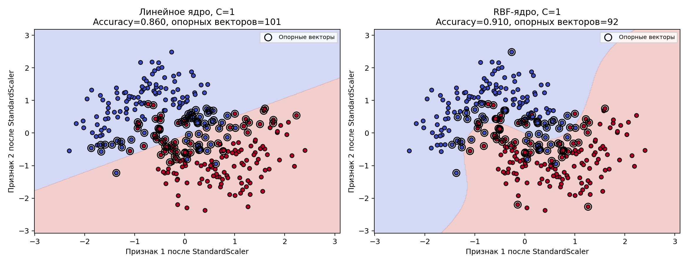
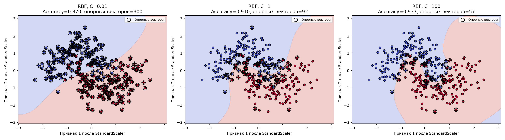

# Практическая работа № 9. Метод опорных векторов

## Цель работы

Исследовать влияние ядровой функции и гиперпараметра `C` на поведение классификатора SVM.

## Данные

Для эксперимента использован искусственный двумерный датасет `make_moons`.

Параметры датасета:

- количество объектов: 300;
- количество признаков: 2;
- количество классов: 2;
- объектов класса 0: 150;
- объектов класса 1: 150;
- уровень шума: 0.25.

Такой датасет выбран потому, что классы имеют форму двух полумесяцев и не разделяются одной прямой линией.

## Масштабирование

Перед обучением признаки были масштабированы с помощью `StandardScaler`.

После масштабирования:

- средние значения признаков близки к 0;
- стандартные отклонения равны 1.

Масштабирование обязательно для SVM, потому что модель использует расстояния между объектами. Без масштабирования признак с большими числовыми значениями влиял бы на результат сильнее остальных.

## Сравнение ядер

| Ядро | C | Accuracy на обучении | Опорных векторов |
|---|---:|---:|---:|
| Linear | 1 | 0.860 | 101 |
| RBF | 1 | 0.910 | 92 |

Линейное ядро строит прямую границу и не может точно разделить два полумесяца.

RBF-ядро строит нелинейную изогнутую границу, повторяющую форму данных. Поэтому его accuracy выше: 0.910 против 0.860.



## Влияние параметра C

| C | Accuracy на обучении | Опорных векторов |
|---:|---:|---:|
| 0.01 | 0.870 | 300 |
| 1 | 0.910 | 92 |
| 100 | 0.937 | 57 |

Параметр `C` определяет строгость штрафа за ошибки:

- `C = 0.01` — модель допускает ошибки ради широкой и простой границы. Все 300 объектов стали опорными;
- `C = 1` — компромисс между простотой границы и точностью;
- `C = 100` — ошибки сильно штрафуются, поэтому модель точнее подстраивается под обучающие объекты. Accuracy выросла до 0.937, но увеличился риск переобучения.



## Вывод

Для датасета `make_moons` лучше подошло RBF-ядро, поскольку классы нельзя хорошо разделить прямой линией.

Увеличение `C` повысило точность на обучающей выборке, но высокая обучающая точность не гарантирует такое же качество на новых данных. Слишком большое значение `C` может привести к переобучению.

Оптимальным из рассмотренных вариантов можно считать RBF с `C = 1`: модель получила хорошую точность и сохранила более умеренную сложность границы.

## Запуск

```bash
python3 -m venv .venv
source .venv/bin/activate
pip install -r requirements.txt
python3 svm_practice.py
```

После запуска создаются:

- `kernel_comparison.png`;
- `c_comparison.png`;
- текстовые результаты в терминале.
